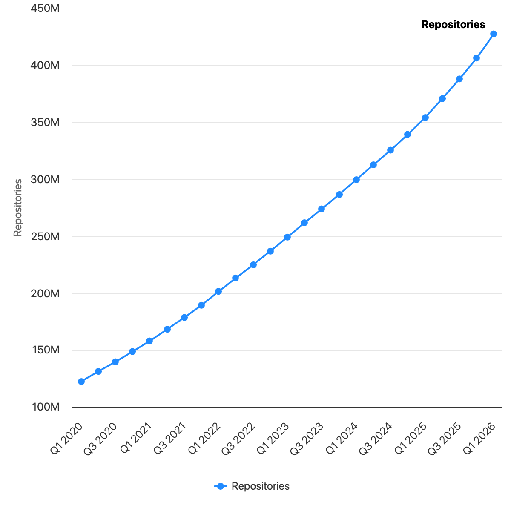
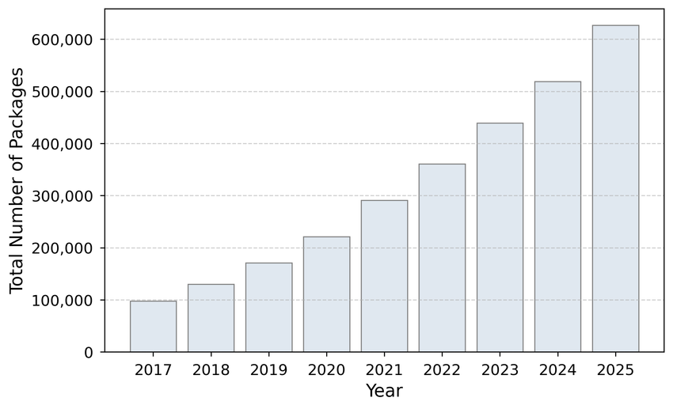

# Notes on software discovery

How people find the software they build on has been reinvented roughly every five years. Each era changes not just *where* you look, but who gets found.

* 1993: We discover software through peers and publications.
    * The channels are human-scaled: Usenet newsgroups (`comp.sources.unix`, `comp.lang.*`), BBSes, word of mouth at LUGs, universities, and offices.
    * Software lives on FTP archives (Simtel, `wuarchive.wustl.edu`, `ftp.funet.fi`) and gets distributed on magazine cover discs and CD-ROM collections (Walnut Creek).
    * First search tools for that world: [Archie](https://en.wikipedia.org/wiki/Archie_(search_engine)) (1990) indexes FTP sites; Gopher/Veronica (1991–92) and WAIS try directory-style discovery.
    * Curation is editorial: computer magazines (BYTE, Dr. Dobb's), books with source on floppy, shareware catalogs.
* 2000: You used a search index to find software, it was scattered across the web, with a few sites trying to be a source and package host.
    * Google (1998) and AltaVista before it find software *wherever it lives* — and it lives everywhere: every project is its own homepage, tarball over FTP, README in ASCII.
    * Portals try to aggregate the scatter: [Freshmeat](https://en.wikipedia.org/wiki/Freshmeat) (1999) as the release-announcement firehose, [SourceForge](https://en.wikipedia.org/wiki/SourceForge) (1999) as host + directory, Tucows, Download.com, dmoz.
    * Domain-specific archives predate the portals and quietly become the durable model: CTAN (1992), CPAN (1995) — searchable, versioned, installable.
    * Ratings and download counts emerge as the first ranking signals.
* 2010: Before git, open source collaboration was difficult. Git and GitHub changed that and opened up code and collaboration; social networks provide commentary, guidance, feedback, reach, and more.
    * Git (2005) unbundles contribution from committership; GitHub (2008) makes projects *social*: watch, follow, fork. READMEs become homepages; issues become support forums.
    * Guidance moves to a second layer of social sites: Stack Overflow (2008), Hacker News, Twitter, Reddit. You discover software through *people* now, not just keywords.
    * New signals: stars, forks, contributors, activity — proxies for quality and aliveness.
    * Package registries become a discovery surface in their own right: npm (2010), RubyGems, PyPI, Maven Central. Search happens where you install. "Awesome" lists (2014+) add hand-curated layers back on top.
* 2016: [Open Source Won](https://www.wired.com/2016/08/open-source-won-now/)

    * "Build vs. buy" collapses into "find a library for it." Every company ships open source; depending on strangers' code is now the default, not the exception.
    * With dependency as default, the real questions shift: Is it maintained? Licensed? Safe? ([left-pad](https://en.wikipedia.org/wiki/Npm#Left-pad_incident), 2016, is the first mainstream wake-up call.)
* 2020: Acceleration, more packages, everything get streamlined, better packaged, deployed, CI/CD, cloud, containers

    * The pipeline is fully streamlined: containers, CI/CD everywhere (GitHub Actions, 2019), cloud-native registries. Shipping software — and thus *accumulating* software — gets cheap.
    * Discovery moves inside the toolchain: Dependabot and Renovate *suggest* packages; transitive dependencies mean you run code you never explicitly chose.
    * Scale becomes the problem: millions of packages, ~everything a wrapper around something smaller.
    * Flip side of abundance: supply-chain anxiety. SolarWinds (2020), Log4Shell (2021) make *provenance and maintenance health* part of discovery — CVEs, SBOMs, OpenSSF scorecards.
* 2023: LLM era, coding helper
    * ChatGPT (late 2022) and Copilot make "what library should I use for X?" a conversation instead of a search. The model synthesizes a consensus answer from its training data.
    * Fast and convenient, but biased toward the popular: models recommend what they saw most of, tightening rich-get-richer dynamics.
    * New failure mode: models hallucinate plausible package names — [slopsquatting](https://en.wikipedia.org/wiki/Slopsquatting) registers them for real.
    * Documentation starts being written for two readers: humans and models (llms.txt, 2024).
* 2025: agentic coding, LLM intermediation
    * Agents don't just recommend software, they *choose* it: they search, read READMEs, issues, and source, weigh options, and add dependencies themselves. Discovery is now machine-intermediated.
    * Signals get consumed by machines: download counts, stars, changelogs, test coverage, MCP servers (2024) — software needs to be *agent-legible* to be found at all.
    * Trust is the open wound: the [xz backdoor](https://en.wikipedia.org/wiki/Xz_Utils_backdoor) (2024) showed both how social engineering targets a maintainer's exhaustion and how deep the dependency tree goes.
    * The reader an author writes for is increasingly not the person installing the package.

## Open questions (for upsweep)

* When the *reader* is an agent, what does discovery mean? Whose ranking do agents trust, and how is it gamed?
* Maintenance health, provenance, and agent-legibility look like the new ranking signals — who computes them credibly?
* Every era since 1993 has favored the already-popular (publications → download counts → stars → training data). Can the long tail be discoverable again, or is intermediation by machines the final consolidation?
* Discovery used to be pull (search) with a push layer (peers, feeds). Agents are pull at machine speed — what is the push layer now?

## See also

* Scenarios for 2027–2035: [2026-10-01-software-discovery-scenarios.md](2026-10-01-software-discovery-scenarios.md)
